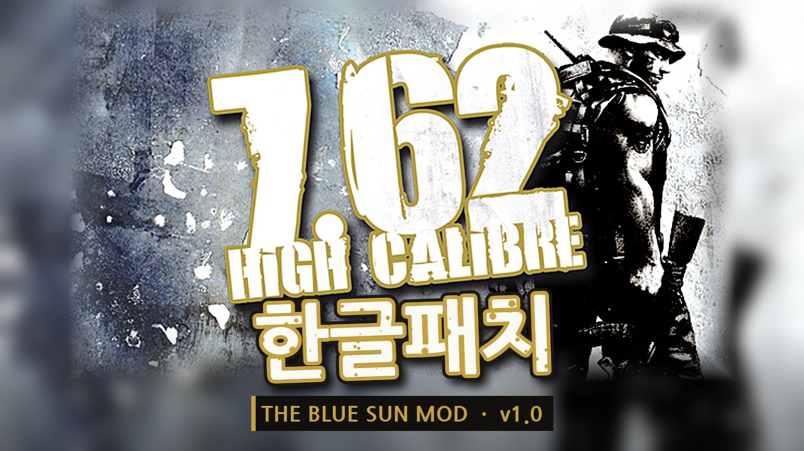
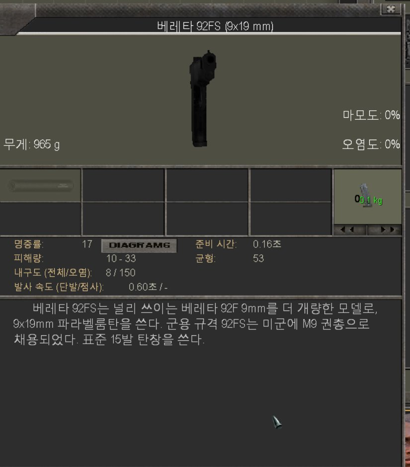
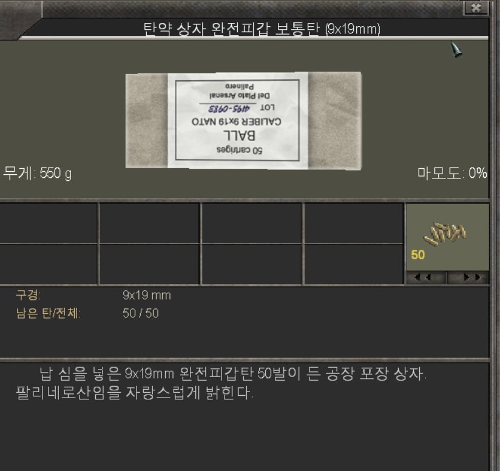
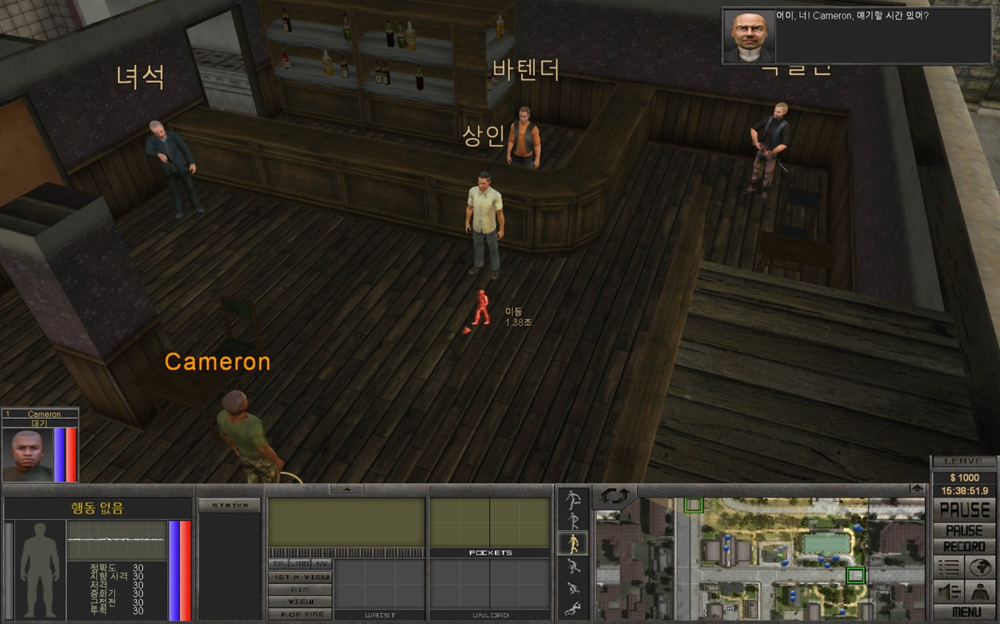
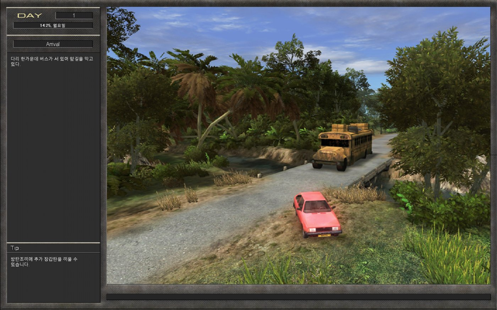

# 7.62 하이 캘리버 (The Blue Sun Mod) 한글 패치

7.62 High Calibre(Steam판)에 **The Blue Sun Mod**를 설치한 환경을 위한 비공식 한글 패치입니다.
메뉴부터 본편 퀘스트, Blue Sun 미션 대화, 아이템 설명까지 게임 텍스트 거의 전부를 한글로 옮겼습니다.
원본 게임 파일은 하나도 덮어쓰지 않습니다.

**[⬇ 다운로드 (Releases)](../../releases/latest)**

| | |
|---|---|
|  |  |
|  |  |

## 번역 범위
- 메뉴, 인터페이스, 시스템 메시지
- 본편 퀘스트, 대화, 일지 + Blue Sun 미션 팩(47개 미션) 대화와 문구
- 로딩 팁, 지역(섹터) 설명, 인물 소개, NPC 머리 위 이름표
- 용병 대사 자막 약 1,600줄
- 아이템 이름과 설명 약 2,900개, 툴팁

번역하지 않은 것: 이미지로 된 버튼 글자, 모델명만 있는 무기 이름(일부러 원문 유지),
게임 내부에서 식별자로 쓰이는 일부 인물 이름과 스크립트 값.

## 필요한 것
- 7.62 High Calibre Steam판, `EB.exe` 1.11 build 286
- The Blue Sun Mod (Steam판, 게임 폴더에 `BlueSun.azp`)
- Windows 기본 글꼴 "맑은 고딕"

## 설치 / 제거
1. 게임을 끕니다.
2. [Releases](../../releases/latest)에서 zip을 받아 게임 폴더(`EB.exe`가 있는 곳)에 그대로 풉니다.
3. `install_korean.bat`를 실행합니다. (`INI\vfs.ini` 맨 위에 `Korean.azp` 한 줄을 추가하고, 원본은 `vfs.ini.kor_bak`로 보관)
4. 평소처럼 게임을 실행합니다.

제거는 게임을 끄고 `uninstall_korean.bat`를 실행하면 됩니다.

> 게임 폴더에 다른 `d3d9.dll`(ReShade 등)이 있으면 덮어쓰게 되며 함께 쓸 수 없습니다.

## 문제 해결
- 영어 그대로라면 `INI\vfs.ini` 맨 윗줄이 `"Korean.azp"`인지 확인하고 `install_korean.bat`를 다시 실행하세요.
- 게임 폴더의 `kor_d3d9.log`에 DLL 동작 기록이 남습니다. `signature mismatch`는 EB.exe 버전이 다르다는 뜻입니다.
- 빈 파일 `kor_debug.txt`를 만들면 화면에 그려지는 문자열을 로그에 모두 기록합니다(제보용).
- DLL은 런처 없이 `EB.exe`를 직접 실행했을 때 `HLA.dll`을 대신 불러옵니다. 끄려면 빈 파일 `kor_nohla.txt`를 만드세요.

오역이나 깨지는 글자는 [Issues](../../issues)에 스크린샷과 함께 알려 주세요.

## 알려진 문제
- 화면 왼쪽 아래 기술 목록의 글자 줄이 겹쳐 보일 수 있습니다.
- 이미지로 된 버튼 글자는 영어입니다.

## 동작 방식 (개발자용)
- `src/kor_d3d9` — `d3d9.dll` 프록시. 게임의 글씨 그리기 함수(화면 텍스트, 텍스트→비트맵, 툴팁)를 후킹해
  KS X 1001(EUC-KR) 2바이트 글자를 GDI(맑은 고딕)로 그립니다. 그 밖에 낱개 파일 읽기를 `Korean\` 폴더로
  돌리고(`e6q.txt`), Blue Sun 퀘스트 스크립트의 문자열 상수를 로드 시점에 바꿉니다(`kor_quest.txt`).
- `tools/` — AZP 팩 읽기/쓰기(`azp.py`), 텍스트 추출(`extract.py`), 번역 빌드(`build_kor.py`).
  추출 결과(영어 원문)는 저장소에 넣지 않았습니다. 자기 게임에서 `extract.py`로 다시 만들 수 있습니다.
- `trans/ko/` — 번역문(JSONL, `{"k": 키, "ko": 번역}`), `trans/glossary.md` — 용어집.
- 개발 기록: `MODLOG.md`

빌드: `src/kor_d3d9/build.cmd`(Visual Studio x86) → `python tools/extract.py` → `python tools/build_kor.py` → `build/`

## 만든 사람
- 원작: 7.62 High Calibre — Apeiron / 1C
- The Blue Sun Mod — R@S와 Blue Sun Mod 참여자들, Unofficial Patch, Hard Life Addon(HLA) 제작자들
- 이 한글 패치의 번역과 DLL 코드는 Anthropic의 Claude(Claude Code, Claude Opus 5.5)가 작성했고,
  저장소 주인이 방향을 정하고 게임에서 직접 확인했습니다. AI 번역이라 어색한 부분이 있을 수 있습니다.

비공식 팬 패치이며 원작사나 Blue Sun Mod 제작진과 관계가 없습니다. 게임과 모드의 권리는 각 권리자에게 있습니다.

## 라이선스
- 코드(`src/`, `tools/`, 설치 스크립트): MIT — `LICENSE`
- 번역문(`trans/ko/`, 배포 zip의 번역 텍스트): 비상업적 이용만 허용합니다. 판매를 금지합니다.
